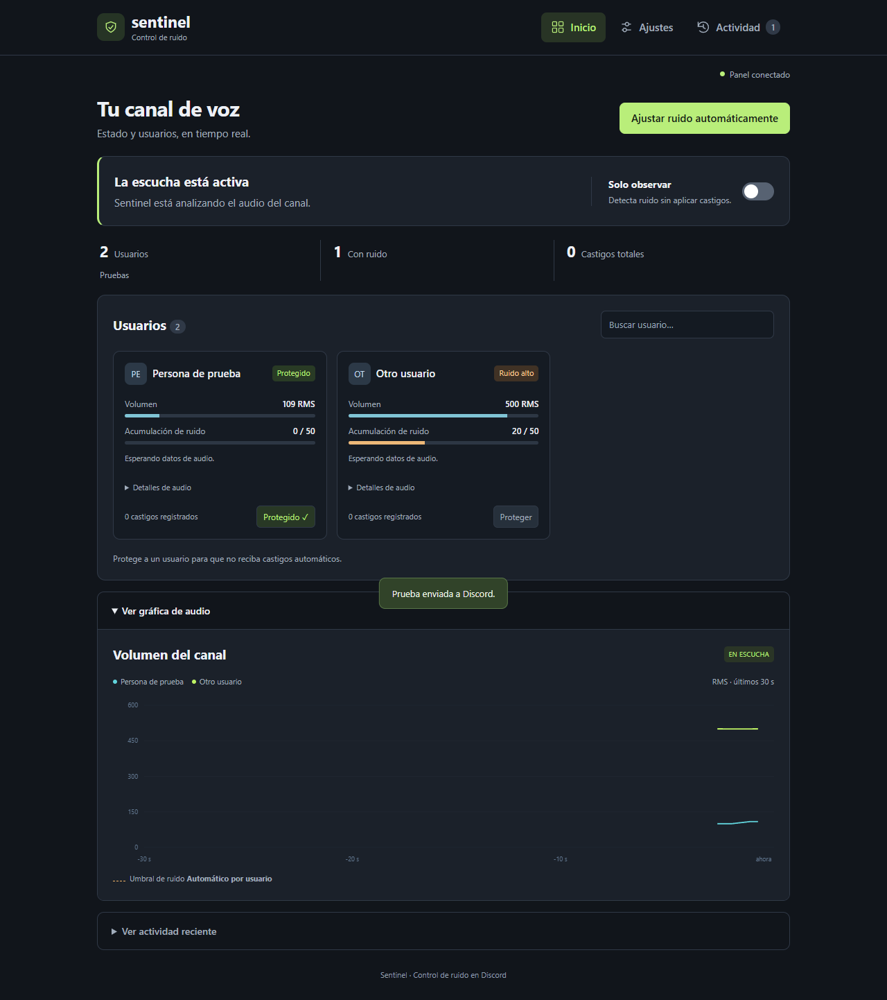

<div align="center">

# 🛡️ Sentinel

### Moderación de audio en tiempo real para Discord

**Un bot de voz con análisis DSP local, calibración por ambiente y un panel web para entender qué está pasando antes de actuar.**

[Ver el proyecto](https://github.com/Brasther/sentinel-discord-bot) · [Instalación paso a paso](docs/INSTALACION_WINDOWS.md) · [Reportar un problema](https://github.com/Brasther/sentinel-discord-bot/issues)

**Python 3.12** · **discord.py** · **Flask** · **SQLite** · **WebRTC VAD**

</div>

---

## El proyecto

Sentinel escucha el audio que Discord entrega al bot, analiza señales por usuario y presenta el estado del canal en un dashboard local. Está pensado para probar, calibrar y moderar con controles visibles, empezando siempre en modo de observación.

> La detección de voz y ruido es heurística: no identifica si un sonido viene de una persona, una TV o una aplicación. Puede haber falsos positivos. Revisa los resultados antes de activar medidas automáticas.

## Vista del panel

La captura muestra datos de demostración; no representa una conexión real a Discord.

<p align="center">
  
</p>

## Qué puedes hacer

- **Observar audio por usuario:** niveles RMS, estado, infracciones y actividad reciente.
- **Calibrar el ambiente:** estima un umbral usando muestras de fondo sin voz.
- **Ajustar controles individuales:** sensibilidad, gracia, perfil y protección de voz.
- **Probar sin bot:** abrir una demo aislada con datos simulados.
- **Recuperar la escucha:** vigilar desconexiones y conservar el estado al recargar el motor de audio.

## Inicio rápido

### Requisitos

- Windows 10/11 y Python 3.12.
- Un bot creado en [Discord Developer Portal](https://discord.com/developers/applications).
- Un servidor donde puedas invitar el bot y configurar permisos.

### Instalar

1. Descarga el [ZIP del proyecto](https://github.com/Brasther/sentinel-discord-bot/archive/refs/heads/main.zip) y descomprímelo.
2. En Discord Developer Portal, crea el bot, activa **Message Content Intent** y copia el token.
3. Ejecuta **`Iniciar_Sentinel.cmd`**. El asistente te pedirá el token sin mostrarlo y lo guardará localmente.
4. Espera a que se instalen las dependencias y abre **http://localhost:5000**.
5. Entra a un canal de voz y escribe **`!vigilar`** en un canal de texto.

La primera ejecución crea `.venv` e instala los paquetes. Sentinel requiere Python 3.12 y conexión a Internet durante esta instalación.

> **¿Primera vez con bots de Discord?** Sigue la [guía completa de instalación](docs/INSTALACION_WINDOWS.md), con permisos, invitación al servidor y solución de problemas.

### Probar la demo

Ejecuta **`Ver_Panel_Demo.cmd`** y abre **http://localhost:5001**. No necesita token, no se conecta a Discord y no puede aplicar moderación.

## Diseño y arquitectura

```text
Discord Voice ──► receptor PCM ──► AudioEngine por usuario
                                       │
                            filtro + VAD + RMS + umbral
                                       │
                    puntuación / observación / moderación
                                       │
            SQLite ◄── eventos y ajustes ──► Flask + Socket.IO
                                                │
                                       panel local del navegador
```

- **Audio:** procesa PCM mono a 48 kHz en bloques de 20 ms. El motor mantiene estado separado por usuario y combina RMS filtrado, detector VAD y evidencia temporal.
- **Calibración:** calcula el percentil 90 de muestras válidas de fondo y requiere al menos 25 bloques sin voz.
- **Persistencia:** guarda configuración, métricas y recuperación de moderación en SQLite.
- **Interfaz:** Flask y Socket.IO sirven el panel solo en `127.0.0.1` de forma predeterminada.
- **Actualización del detector:** puede recargar `sentinel_audio.py` en caliente si el nuevo motor puede migrar el estado activo.

Más detalle sobre umbrales, modos y limitaciones: [`AUDIO.md`](AUDIO.md).

## Stack

| Área | Tecnología |
| --- | --- |
| Bot y eventos de voz | Python 3.12, discord.py, discord-ext-voice-recv |
| Procesamiento de señal | NumPy, SciPy, WebRTC VAD |
| Dashboard en tiempo real | Flask, Flask-SocketIO, JavaScript |
| Persistencia | SQLite |
| Inicio en Windows | Scripts `.cmd` y entorno virtual creado automáticamente |

## Seguridad y privacidad

- El token se guarda en `.env`; ese archivo está excluido de Git. Si se filtra, regénéralo desde Discord Developer Portal.
- El audio se analiza localmente en memoria; Sentinel no lo graba ni lo envía a servicios externos. Discord transporta el audio al bot para que pueda analizarlo.
- El dashboard no tiene autenticación remota. Mantén `SENTINEL_HOST=127.0.0.1` y no publiques el puerto en Internet.
- Para conectar voz, concede los permisos mínimos necesarios. Para moderar, el bot requiere permisos adicionales de silenciar o mover miembros.

## Desarrollo

```powershell
py -3.12 -m venv .venv
.venv\Scripts\python.exe -m pip install -r requirements.txt
.venv\Scripts\python.exe -m unittest discover -s tests -v
```

La demo se puede iniciar con `Ver_Panel_Demo.cmd`. Para contribuir, consulta [`CONTRIBUTING.md`](CONTRIBUTING.md). Las pruebas cubren el motor de audio, persistencia SQLite, runtime y recuperación.

## Documentación

- [Instalación en Windows](docs/INSTALACION_WINDOWS.md)
- [Motor de audio y sus límites](AUDIO.md)
- [Cambios](CHANGELOG.md)
- [Contribuir](CONTRIBUTING.md)
- [Seguridad](SECURITY.md)

## Alcance y estado

Sentinel está preparado para Windows con Python 3.12. No se presenta como clasificador de TikTok, música o habla humana: analiza características de la señal y su duración, no el origen semántico del sonido. El uso de castigos debe empezar desactivado y validarse en el servidor donde se instalará.

## Licencia

El repositorio no incluye una licencia. Puedes descargar y consultar el código, pero no hay permisos generales definidos para reutilizarlo, modificarlo o redistribuirlo.

<div align="center">

**Hecho como proyecto personal de ingeniería de software y procesamiento de audio.**

</div>
